# dzdcache against Hazelcast, Ignite, Infinispan and Redis Stack

dzdcache is a distributed in-memory cache built for searching cached objects. Every node holds a complete replica with indexes on the fields that are searched, so a search runs on the node that receives it, without asking the other nodes. Embedded in an application, dzdcache searches the replica in the application's own JVM and returns the cached objects themselves, with no network call and no deserialization. The dzdcache server does the same inside its container, so a search costs one HTTP round trip.

This benchmark compares dzdcache with Hazelcast, Apache Ignite, Infinispan and Redis Stack in five searches: an exact match, a name prefix, a numeric range, a city combined with an age range, and a value in a nested collection. Lookups by id and writes are measured as well.

## Key findings

With 50,000 cached people:

- **Embedded:** dzdcache answered 15–40× as many searches per second as the fastest other embedded cache, in each of the 5 searches.
- **Server:** the dzdcache server answered 1.7–5.7× as many searches per second as redis-stack.

| Search | Embedded: dzdcache against the fastest other | Server: dzdcache against the fastest other |
|---|---|---|
| Exact | 40× ignite | 4.8× redis-stack |
| Prefix | 26× ignite | 1.7× redis-stack |
| Range | 38× ignite | 5.7× redis-stack |
| Compound | 31× ignite | 3.4× redis-stack |
| Nested collection | 15× hazelcast | 5.4× redis-stack |

### Where the others are faster

dzdcache is built to search cached data, not to win every caching benchmark. With 50,000 people:

- infinispan's get by id is 12× as fast as dzdcache embedded's.
- hazelcast's put is 2.9× as fast as dzdcache embedded's.
- redis-stack's get by id is 1.6× as fast as the dzdcache server's.
- redis-stack's put is 3.9× as fast as the dzdcache server's.
- dzdcache embedded holds 1,556 bytes per cached person on each node, against 324–608 for the other embedded caches, although the measurements are not fully equivalent (see [memory](#memory-consumption-and-measurement-limitations)).

These numbers describe this benchmark: clusters of three nodes on one machine, with these data sizes and these queries. They are not a prediction of performance in production, where the nodes run on separate machines.

## What was tested

- Every subject runs a cluster of three nodes. Data is loaded through node 1, and every measured call is made on node 2 by 4 threads.
- The subjects fall into two groups, and results are only compared within a group:
  - **Embedded caches** run inside the application's JVM, and the application calls them directly. The three nodes of each cluster run in one JVM and talk over loopback networking. These are dzdcache-embedded, hazelcast, ignite, infinispan.
  - **Remote cache servers** run as three Docker containers on one Docker network, and the benchmark calls node 2 through Docker's port mapping, so every call pays for a network round trip and serialization. These are dzdcache-server, redis-stack.
- Everything runs on one machine, with 1,000 to 50,000 cached people.
- Every search returns the matching people as complete objects; nothing is only counted. A test checks that every subject returns exactly the same people for every query, with 1,000 people. On average, a search returns:

| Search | 1,000 people | 10,000 people | 50,000 people |
|---|---:|---:|---:|
| Exact | 21 | 199 | 997 |
| Prefix | 3 | 16 | 77 |
| Range | 159 | 1,579 | 7,914 |
| Compound | 2 | 32 | 155 |
| Nested collection | 136 | 1,393 | 6,960 |

The details of the measurement are under [Methodology](#methodology), and each subject's configuration is at the end.

## Embedded caches — local searches

### Indexed search performance

#### Exact: everyone who lives in a city

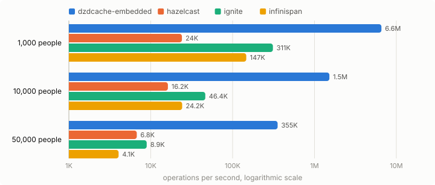

| Subject | 1,000 people | 10,000 people | 50,000 people |
|---|---:|---:|---:|
| dzdcache-embedded | 6,567,364 ± 271,333 | 1,521,328 ± 242,256 | 354,929 ± 78,515 |
| hazelcast | 24,046 ± 2,318 | 16,199 ± 562 | 6,757 ± 470 |
| ignite | 310,531 ± 9,901 | 46,368 ± 1,877 | 8,928 ± 329 |
| infinispan | 146,776 ± 554 | 24,206 ± 1,470 | 4,051 ± 222 |

#### Prefix: names starting with two letters

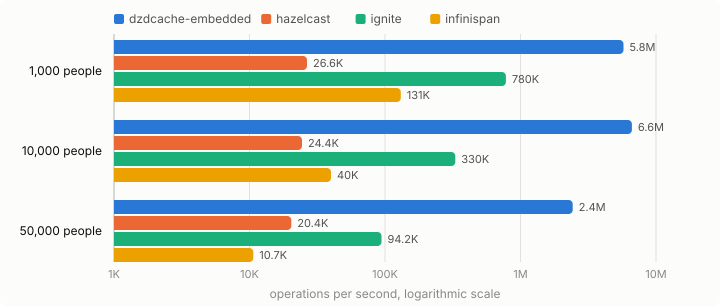

| Subject | 1,000 people | 10,000 people | 50,000 people |
|---|---:|---:|---:|
| dzdcache-embedded | 5,759,971 ± 610,612 | 6,636,151 ± 324,565 | 2,426,479 ± 82,936 |
| hazelcast | 26,565 ± 336 | 24,418 ± 344 | 20,354 ± 578 |
| ignite | 779,776 ± 10,342 | 330,266 ± 1,645 | 94,179 ± 1,371 |
| infinispan | 130,881 ± 1,577 | 39,965 ± 1,572 | 10,665 ± 1,038 |

#### Range: ages within ten years

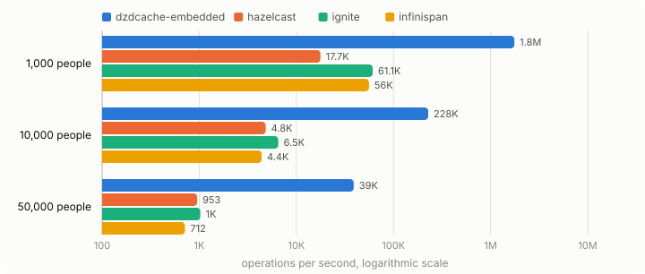

| Subject | 1,000 people | 10,000 people | 50,000 people |
|---|---:|---:|---:|
| dzdcache-embedded | 1,761,199 ± 115,552 | 228,066 ± 3,823 | 38,954 ± 1,513 |
| hazelcast | 17,711 ± 445 | 4,833 ± 113 | 953 ± 76 |
| ignite | 61,112 ± 2,247 | 6,516 ± 63 | 1,026 ± 25 |
| infinispan | 56,028 ± 3,897 | 4,386 ± 176 | 712 ± 31 |

#### Compound: a city and an age range

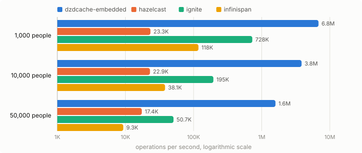

| Subject | 1,000 people | 10,000 people | 50,000 people |
|---|---:|---:|---:|
| dzdcache-embedded | 6,819,828 ± 295,742 | 3,845,137 ± 837,196 | 1,594,283 ± 35,710 |
| hazelcast | 23,275 ± 3,784 | 22,903 ± 514 | 17,376 ± 736 |
| ignite | 727,568 ± 23,795 | 195,315 ± 2,407 | 50,743 ± 2,582 |
| infinispan | 117,990 ± 4,103 | 38,139 ± 2,020 | 9,299 ± 389 |

#### Nested collection: everyone with a tag

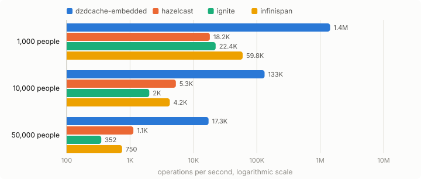

| Subject | 1,000 people | 10,000 people | 50,000 people |
|---|---:|---:|---:|
| dzdcache-embedded | 1,433,124 ± 29,999 | 132,667 ± 8,837 | 17,345 ± 775 |
| hazelcast | 18,154 ± 520 | 5,291 ± 464 | 1,128 ± 37 |
| ignite | 22,429 ± 459 | 2,011 ± 218 | 352 ± 16 |
| infinispan | 59,775 ± 2,909 | 4,242 ± 256 | 750 ± 24 |

### Key lookups and write performance

dzdcache is built for the searches above. Lookups by id and writes are shown for completeness.

#### get by id

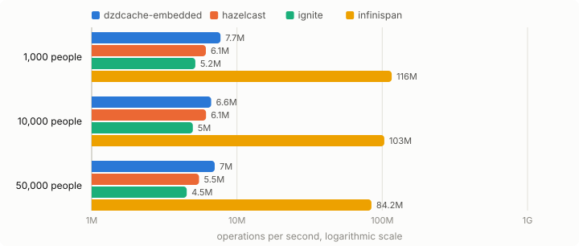

| Subject | 1,000 people | 10,000 people | 50,000 people |
|---|---:|---:|---:|
| dzdcache-embedded | 7,703,413 ± 401,494 | 6,645,990 ± 1,008,220 | 7,027,320 ± 711,362 |
| hazelcast | 6,105,822 ± 322,620 | 6,126,553 ± 98,475 | 5,484,493 ± 88,490 |
| ignite | 5,171,150 ± 538,537 | 4,967,381 ± 114,098 | 4,508,078 ± 239,877 |
| infinispan | 116,168,870 ± 37,408,469 | 103,326,850 ± 408,997 | 84,216,698 ± 4,402,574 |

#### put

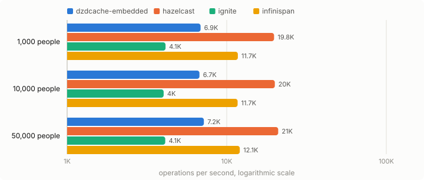

| Subject | 1,000 people | 10,000 people | 50,000 people |
|---|---:|---:|---:|
| dzdcache-embedded | 6,859 ± 74 | 6,749 ± 170 | 7,189 ± 109 |
| hazelcast | 19,795 ± 255 | 20,019 ± 403 | 21,022 ± 1,527 |
| ignite | 4,136 ± 68 | 4,025 ± 68 | 4,120 ± 124 |
| infinispan | 11,745 ± 127 | 11,703 ± 230 | 12,080 ± 214 |

## Remote cache servers — network searches

### Indexed search performance

#### Exact: everyone who lives in a city

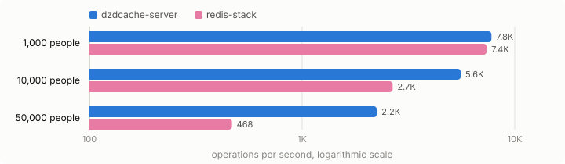

| Subject | 1,000 people | 10,000 people | 50,000 people |
|---|---:|---:|---:|
| dzdcache-server | 7,770 ± 155 | 5,569 ± 240 | 2,246 ± 50 |
| redis-stack | 7,374 ± 186 | 2,666 ± 45 | 468 ± 16 |

#### Prefix: names starting with two letters

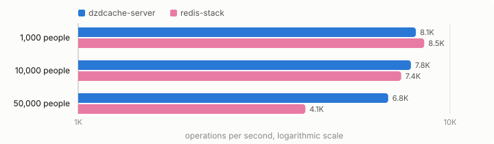

| Subject | 1,000 people | 10,000 people | 50,000 people |
|---|---:|---:|---:|
| dzdcache-server | 8,090 ± 200 | 7,845 ± 118 | 6,817 ± 133 |
| redis-stack | 8,518 ± 110 | 7,385 ± 444 | 4,082 ± 91 |

#### Range: ages within ten years

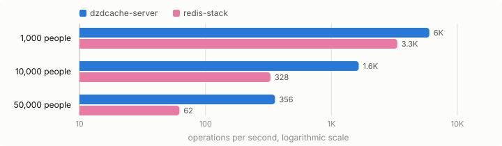

| Subject | 1,000 people | 10,000 people | 50,000 people |
|---|---:|---:|---:|
| dzdcache-server | 5,990 ± 135 | 1,647 ± 45 | 356 ± 15 |
| redis-stack | 3,335 ± 59 | 328 ± 7 | 62 ± 2 |

#### Compound: a city and an age range

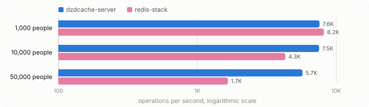

| Subject | 1,000 people | 10,000 people | 50,000 people |
|---|---:|---:|---:|
| dzdcache-server | 7,589 ± 1,319 | 7,538 ± 107 | 5,724 ± 801 |
| redis-stack | 8,161 ± 258 | 4,307 ± 93 | 1,660 ± 26 |

#### Nested collection: everyone with a tag

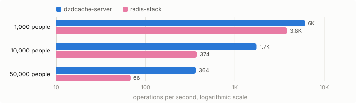

| Subject | 1,000 people | 10,000 people | 50,000 people |
|---|---:|---:|---:|
| dzdcache-server | 6,038 ± 161 | 1,734 ± 34 | 364 ± 20 |
| redis-stack | 3,815 ± 159 | 374 ± 7 | 68 ± 7 |

### Key lookups and write performance

dzdcache is built for the searches above. Lookups by id and writes are shown for completeness.

#### get by id

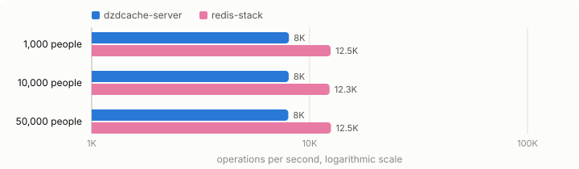

| Subject | 1,000 people | 10,000 people | 50,000 people |
|---|---:|---:|---:|
| dzdcache-server | 8,040 ± 236 | 8,017 ± 301 | 7,985 ± 265 |
| redis-stack | 12,496 ± 266 | 12,347 ± 833 | 12,534 ± 74 |

#### put

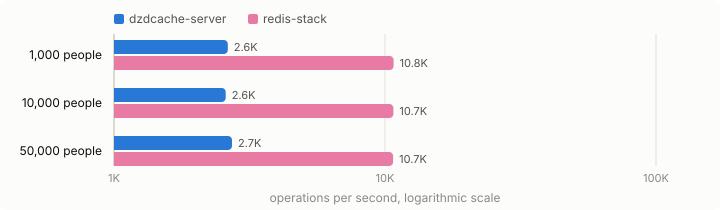

| Subject | 1,000 people | 10,000 people | 50,000 people |
|---|---:|---:|---:|
| dzdcache-server | 2,630 ± 315 | 2,583 ± 230 | 2,726 ± 216 |
| redis-stack | 10,756 ± 117 | 10,740 ± 321 | 10,713 ± 118 |

## Observed write visibility

1,000 writes through node 1, each read back on node 2 as soon as it was acknowledged. No stale reads in this test is evidence from this run, not proof of a guarantee; what dzdcache guarantees, and the one case it does not cover, is in [consistency and failure behavior](https://github.com/zdcache/dzdcache/blob/main/docs/CONSISTENCY.md).

| Subject | Runs | Writes | Stale or missing on node 2 |
|---|---|---:|---:|
| dzdcache-embedded | embedded | 1000 | 0 |
| dzdcache-server | remote server | 1000 | 0 |
| hazelcast | embedded | 1000 | 0 |
| ignite | embedded | 1000 | 0 |
| infinispan | embedded | 1000 | 0 |
| redis-stack | remote server | 1000 | 0 |

## Memory consumption and measurement limitations

Memory per cached person on one node. The figures were not all obtained the same way, as the How column says: the retained heap of the JVM the nodes run in, a data region outside the heap, or the memory a server reports about itself. These are not directly equivalent. The chart only shows the embedded caches; a remote cache server's figure is only comparable with other remote servers.

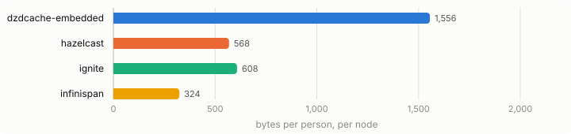

| Subject | Runs | People | Bytes per person | How |
|---|---|---:|---:|---|
| dzdcache-embedded | embedded | 50,000 | 1,556 | retained heap in this JVM divided by its 3 nodes |
| dzdcache-server | remote server | 50,000 | – | not measured: the nodes run in other processes |
| hazelcast | embedded | 50,000 | 568 | retained heap in this JVM divided by its 3 nodes |
| ignite | embedded | 50,000 | 608 | reported by node 2 (off-heap data region) |
| infinispan | embedded | 50,000 | 324 | retained heap in this JVM divided by its 3 nodes |
| redis-stack | remote server | 50,000 | 880 | reported by node 2 (used memory) |

## Methodology

Run on 2026-10-23 (full run) with OpenJDK 64-Bit Server VM 25.0.1 on 11 CPUs, everything on one machine. Docker had 4 CPUs and 6.2 GB of memory for the remote cache servers. Every measurement runs in 3 fresh JVMs that each start their own cluster, and measures 3 × 3 s after a warm-up of 5 × 3 s, so that the JVMs, including the dzdcache servers in Docker, have compiled their hot code before they are measured.

Results are operations per second, where higher is better; ± is the 99.9% confidence interval, shown when there are enough measurements. Each chart shows the table below it on a logarithmic scale, where equal distances are equal ratios, because the subjects differ by up to four orders of magnitude; the exact numbers and their confidence intervals are in the tables.

## How each subject is set up

| Subject | Runs | Settings |
|---|---|---|
| dzdcache-embedded | embedded | 3 Spring Boot starter instances in one JVM over TCP cluster ports; exact city, prefix name, range age, compound city+age and exact-each tags; reads are local on instance 2 and wait for a read lease |
| dzdcache-server | remote server | 3 dzdcache server containers (dzdcache-server:benchmark) on a Docker network; JSON over HTTP/1.1 from java.net.http to server 2 through Docker's port mapping; JSON-only registration with the same dimensions; between the servers framed TCP on the cluster port carrying JSON |
| hazelcast | embedded | Hazelcast 5.7.0, 3 embedded members in one JVM with TCP-IP join on 127.0.0.1; IMap with backupCount=2 (sync), readBackupData=true, in-memory format OBJECT, zero-config Compact serialization of the record; indexes HASH city, SORTED name, SORTED age, SORTED compound city+age and HASH tags[any]; Predicates queries on member 2 |
| ignite | embedded | 3 Ignite 2.17 server nodes in one JVM; REPLICATED TRANSACTIONAL FULL_SYNC caches with SQL indexes on city, name, age and (city, age), tags in a second replicated PERSON_TAG(personId, tag) table indexed on tag, written in the same pessimistic transaction and joined for the tag search; SQL on node 2 runs against its local replica, Ignite's default for replicated tables |
| infinispan | embedded | Infinispan 15.2.6, 3 embedded cache managers in one JVM with JGroups TCP + TCPPING on 127.0.0.1; REPL_SYNC cache storing Java objects (an @Indexed wrapper around the record, replicated with a hand-written ProtoStream schema and MessageMarshaller); local-heap Lucene indexes keyword city, name and tags, numeric age; indexed Ickle queries on node 2 |
| redis-stack | remote server | Redis Stack 7.4 in Docker, a primary and two asynchronous replicas; JSON documents with a RediSearch index of case-sensitive TAG city, name (prefix query) and tags, and NUMERIC SORTABLE age; reads and FT.SEARCH run on replica 1, while put goes to the primary because replicas are read-only |
